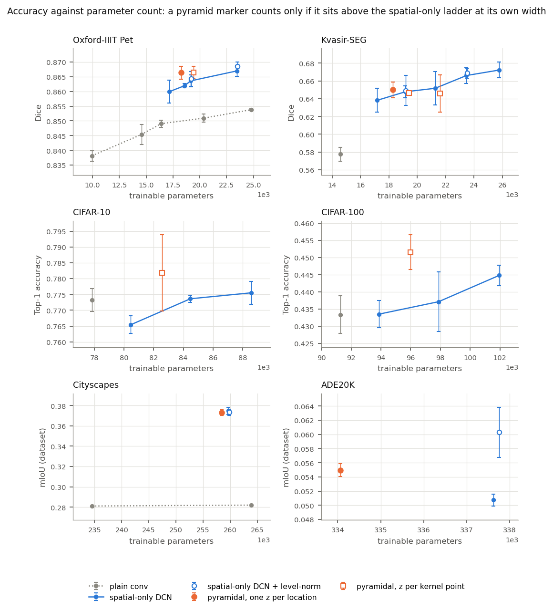
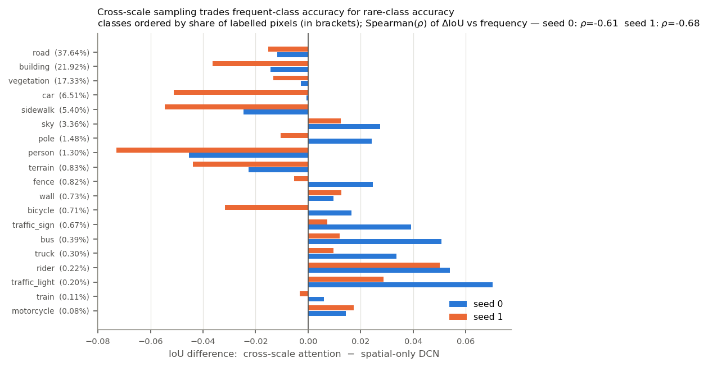
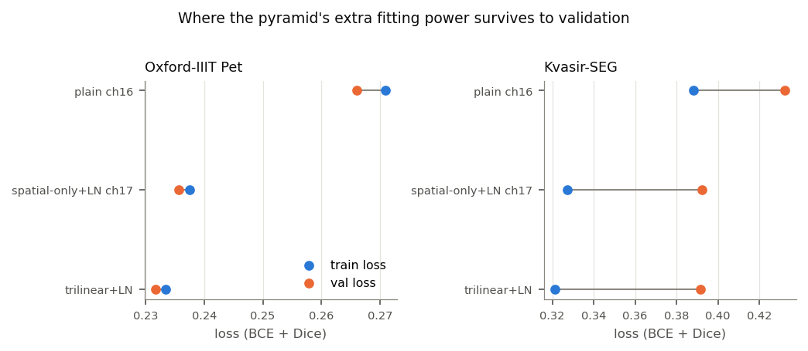
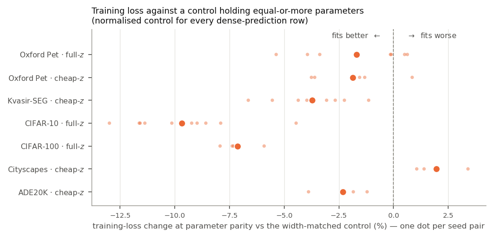
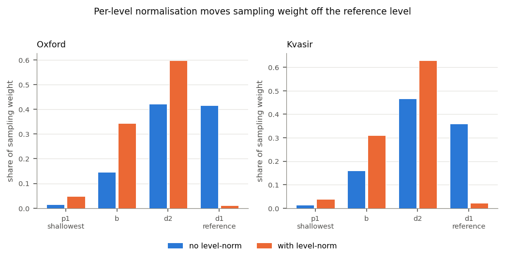

# Pyramidal Deformable Convolution — consolidated results

Single reference for every number the paper cites. Last updated 2026-08-22
(iterations 1–16 + all Kaggle sessions + local LN-control seeds — **the
evidence set is complete; no runs remain open**). Latest: ADE20K conversion
prediction confirmed (§5b, claim 11); redistribution mechanically resolved as
a decision-threshold effect (§5, claim 4; `analyze_prior_shift.py`); the
CIFAR-100 "difficulty redistribution" retired as regression-to-the-mean
(§6c).

**Everything here is regenerable.** Tables: `micromamba run -n ml_env python3
experiments/analyze.py [agg|parity|seeds|cifar|loss|cityscapes]`. Figures:
`… experiments/make_figures.py`. Raw rows: `results/*.csv`; per-image dumps:
`results/per_image/`, `kaggle_artifacts/per_image/`. Training curves
(TensorBoard) and checkpoints are not part of this repository; see `README.md`.

---

## 1. Headline

Claims are graded by the strongest test they survive (§2 explains the two).

**Robust — significant across images *and* across training seeds:**

| # | Claim | Evidence |
|---|---|---|
| 1 | **Spatial deformability is a large win on dense prediction** at capacity parity. | Kvasir +0.067 Dice (seed p<0.001); Oxford +0.016 (p<0.001); Cityscapes +0.0385 per-image mIoU |
| 2 | **Per-level normalisation is required for cross-scale sampling**, and is specific to it, not a generic normaliser. | Pyramid heads +0.028/+0.046 Dice (seed p=0.007) vs ≤+0.0015 (p=0.87) on the DCN control at the same width |
| 3 | **Cross-scale sampling beats a larger spatial-only control where the reference level lacks detail and data is plentiful.** | CIFAR-100 **+1.44 acc pts, seed p=0.017** (vs width-matched ch17) |
| 4 | **On class-starved multi-class segmentation it *redistributes* accuracy from frequent to rare classes** — replicated on every seed of both z formulations, and mechanically resolved (§5): it is a *decision-threshold* effect (normalisation ≈ implicit logit adjustment reproduces it; an explicit λ·log-prior knob on the frozen baseline reproduces it entirely, corr +0.71; attention shifts the threshold furthest). | ρ=−0.61…−0.68 (attention ×3), −0.44…−0.64 (trilinear ×4), −0.43…−0.49 (LN control ×3); λ-sweep: ρ=−0.65/−0.69, frozen-baseline mIoU .3817 |
| 5 | **Plain width is nearly worthless on Cityscapes**, so the deformability gain is not a capacity artefact. | plain ch68 vs ch64: +0.0012 per-image mIoU, p=0.66, at +12.5 % params |
| 6 | **Full-z+LN beats the width-matched control on Oxford at n=8** — the study's first seed-significant val parity win on segmentation (bought by iteration 14). | +0.0027 macro Dice, seeds p=0.032, images p=1e-21; its *train-loss* advantage is significant too (p=0.024) |
| 7 | **At parameter parity the pyramid is the stronger fitter** (train loss, §6) — except the attention arm at ~23k, whose fitting *deficit* on Kvasir is itself seed-significant. | Kvasir cheap-z paired p=4.5e-5 (n=10); CIFAR p≤3e-6; attention deficit p=0.031 (n=6) |
| 8 | **Longer training widens the fit gap; the accuracy gap narrows but holds** (CIFAR-100, 300 vs 150 epochs, vs the width-matched ch17 control). | fit gap −0.161→−0.185 nats (p=2e-15); accuracy gap +1.44→+0.80 pts, p=0.024 (n=10/10) |
| 9 | **Attention at ~23k on Kvasir loses at parity, reproducibly, on both axes** — it fits worse *and* generalises worse than the width-matched control. | val −0.0172, seeds p=0.027; train +0.0139, p=0.011, paired p=0.003 (n=8/8, iter 15) |
| 10 | **Wide regime (Cityscapes, n=4/4): the pyramid fits better across seeds, ties the class-balanced aggregate, and loses the image-balanced metrics** — extra fit buys rare-class recall, not uniform accuracy. | train −0.0303 nats, p=0.029; dataset mIoU p=0.47; per-image mIoU −0.0101, p=0.007 |
| 11 | **Data-rich dense prediction (ADE20K, n=3/3): against the *normalisation-matched* control the pre-registered conversion claim does not hold.** Cheap-z wins per-image mIoU and fits better at seed level, but trails on pixel accuracy and dataset mIoU; most of the original margin over the un-normalised control was the normalisation layer (§5b). | vs single+LN: per-image mIoU **+0.0110** (Welch p=0.007, 3/3), pixel-acc −0.0072 (p=0.070, 0/3), dataset mIoU −0.0047 (p=0.086), train −0.051 (p=0.045). LN alone on the baseline: +0.019 per-image mIoU, +3.1 pixel-acc pts |

**Not resolvable at the seed budget this study can afford** — direction is
recorded, significance is not claimed:

| claim | Δ | images p | seeds p | seeds needed |
|---|---|---|---|---|
| Kvasir: cheap-z vs spatial-only+LN ch17 | +0.0095 | 9e-03 | 0.261 | 59/arm |
| Oxford: cheap-z vs spatial-only+LN ch17 | +0.0022 | 1e-12 | 0.158 | 23/arm |
| Kvasir/Oxford: structured (affine, similarity) vs free offsets | −0.012…+0.002 | 3e-03…3e-08 | 0.15…0.97 | — |

**The seed-level test now separates cleanly:** every mechanism claim passes
it, the two parity comparisons the power analysis rated affordable both
resolved once bought (Oxford full-z+LN: win, row 6; Kvasir attention: loss,
row 9), and the comparisons still open are the ones whose effects sit below
their dataset's resolution floor. CIFAR-100 was always seed-tested and its
effect is far above its 0.005 seed noise.

---

## 2. Protocol

Every comparison is capacity-matched: the spatial-only baseline is widened
(`--channels`) until it has **equal or more** parameters than the pyramid head
it is compared against. Multi-seed throughout. Segmentation significance is reported at **both**
scales — paired Wilcoxon over images and Welch *t* over seeds (see below);
classification is seed-level only, since there is no per-image score.

| | Oxford-IIIT Pet | Kvasir-SEG | CIFAR-10/100 | Cityscapes |
|---|---|---|---|---|
| task | binary seg | binary seg | 10/100-way cls | 19-class seg |
| model | SmallUNet | SmallUNet | SmallClassifier | SmallUNet |
| input | 64×64 | 96×96 | 32×32 | 1024×512, crop 256² |
| train / test | 3 680 / 3 669 | 800 / 200 | 50 000 / 10 000 | 2 975 / 500 |
| epochs | 60 | 60 | 150 | 60 |
| batch | 128 | 64 | 128 | 4 |
| seeds | 3–5 | 3–10 | 3–10 | 1–2 |
| optimiser | Adam 1e-3, wd 1e-5, cosine | ← | ← | ← |
| loss | BCE+Dice (0.5:0.5) | ← | CE, label smoothing 0.1 | CE, ignore 255 |

### Two scales of significance — report both

A comparison can be tested two ways, and they answer different questions:

| test | aggregation | question |
|---|---|---|
| **paired Wilcoxon over images** | average each image's score across seeds, then test across images | do these two *averaged models* differ on this test set? |
| **Welch *t* over seeds** | average each run's score across images, then test across seeds | does the difference *reproduce across training runs*? |

The Wilcoxon has far more power (thousands of images vs a handful of seeds) but
treats the seed-averaged per-image curve as fixed, so with few seeds it will
report a difference that is really seed noise. **They disagree exactly when the
effect is smaller than the seed-to-seed spread**, and on this study that line
falls around 0.005–0.015 Dice depending on dataset.

Per-seed macro-Dice spread, which sets the resolution floor:

| dataset | pooled per-seed sd | smallest Δ resolvable at n=5 / n=10 |
|---|---|---|
| Oxford-IIIT Pet | 0.0025 | 0.0032 / 0.0022 |
| Kvasir-SEG | 0.0110–0.0182 | 0.016 / 0.011 |

`experiments/analyze.py seeds` runs both tests side by side and flags every
disagreement. Any claim below the floor for its dataset is reported as a
direction, not a result.

> **Two metric scales are in play and must never be mixed.** Dice: CSV
> `final_dice` is dataset-level (micro); per-image files and all Wilcoxon Δs are
> per-image means (macro), several points lower. mIoU: CSV `final_miou` is
> dataset-level over all 19 classes; `per_image/*.csv` `miou` is the mean over
> classes present per image. On Cityscapes the two **disagree in sign** — §5.

---

## 3. Accuracy vs capacity

The blue ladder is the spatial-only deformable control at increasing width;
hollow blue markers are that control with level-norm added. A pyramid marker
above the ladder at its own x-position is a genuine win; on or below it is not.
Filled orange = one depth prediction per location (`--z-shared`); hollow orange
= one per kernel point. Error bars are ±1 sd over seeds. Interventions that were
tested and rejected (residual cross-scale, DCNv2 mask, weight-decay and
depth-init sweeps) are excluded here and reported in §4.

Read off the page (six panels since 2026-08-18: the wide regime — Cityscapes
and ADE20K, dataset mIoU — forms the bottom row): the filled orange marker
sits above the baseline on both small segmentation datasets and is the only
pyramid configuration that does so on Kvasir; on ADE20K it clears the baseline
decisively; on Cityscapes it ties. Figure regeneration now excludes
non-canonical rows (structured offsets, offset-LR, offset scaling) — and note
the iter-16 offset-LR CSV rows were retro-tagged (`offset_lr_mult` in options)
because they were originally indistinguishable from baseline cheap-z rows;
`segmentation.csv.bak` holds the pre-repair file.

**Oxford-IIIT Pet** (micro Dice). Bold = the pyramid arms.

| head | params | Dice | ±sd | n |
|---|---|---|---|---|
| plain conv | 14 561 | .8454 | .0034 | 5 |
| spatial-only DCN | 17 171 | .8599 | .0039 | 5 |
| **trilinear +LN +zshared** | **18 260** | **.8664** | .0022 | 5 |
| spatial-only DCN | 19 161 | .8636 | .0020 | 5 |
| spatial-only DCN +LN | 19 195 | .8643 | .0025 | 8 |
| **trilinear +LN** | **19 420** | **.8664** | .0021 | 8 |
| **attention +LN** | **23 335** | **.8684** | .0022 | 5 |
| spatial-only DCN | 23 465 | .8670 | .0018 | 5 |
| spatial-only DCN +LN | 23 503 | .8685 | .0014 | 5 |

**Kvasir-SEG** (micro Dice)

| head | params | Dice | ±sd | n |
|---|---|---|---|---|
| plain conv | 14 561 | .5776 | .0077 | 5 |
| reduced +LN | 15 940 | .6110 | .0136 | 5 |
| reduced spatial-only +LN | 16 731 | .6186 | .0111 | 5 |
| spatial-only DCN | 17 171 | .6382 | .0135 | 5 |
| **trilinear +LN +zshared** | **18 260** | **.6501** | .0089 | 10 |
| attention +LN +zshared | 18 695 | .6432 | .0157 | 3 |
| spatial-only DCN | 19 161 | .6478 | .0067 | 10 |
| spatial-only DCN +LN | 19 195 | .6492 | .0169 | 10 |
| trilinear +LN | 19 420 | .6462 | .0021 | 5 |
| spatial-only DCN | 21 259 | .6517 | .0188 | 3 |
| trilinear +LN ch17 | 21 601 | .6458 | .0208 | 3 |
| attention +LN | 23 335 | .6431 | .0127 | 8 |
| spatial-only DCN | 23 465 | .6661 | .0090 | 8 |
| spatial-only DCN +LN | 23 503 | .6689 | .0057 | 3 |
| spatial-only DCN | 25 779 | .6723 | .0088 | 3 |

The Kvasir width ladder rises ~0.44 Dice pts per 1 000 parameters with no sign
of saturation. Only the cheap-z head (18 260) sits above the ladder at its own
width; every other pyramid configuration tracks below it.

### Cost (params / dense-op FLOPs / measured CPU latency)

`experiments/cost_table.py` (2026-08-11, idle machine, 4 threads, batch 1;
profiler FLOPs exclude `grid_sample`, so pyramid rows are FLOPs lower bounds —
latency is the honest cost):

| config (64², 1-ch head) | params | GFLOPs | ms/img | vs plain |
|---|---|---|---|---|
| plain conv ch16 | 14 561 | 0.058 | 0.8 | 1.0× |
| spatial-only DCN ch17 | 19 161 | 0.090 | 4.9 | 6.0× |
| **cheap-z ch16** | 18 260 | **0.083** | 7.6 | 9.1× |
| full-z+LN ch16 | 19 420 | 0.093 | 7.6 | 9.2× |
| attention+LN ch16 | 23 335 | 0.125 | 8.3 | 10.0× |
| spatial-only DCN ch19 | 23 465 | 0.108 | 5.5 | 6.6× |

Wide regime (256², 19-ch head): plain ch64 67.6 ms / 15.3 GF; single ch66
361 ms / 17.7 GF; cheap-z ch64 675 ms / **17.1 GF**; attention 696 ms /
17.4 GF.

The load-bearing fact for §6: **at matched parameters the pyramid holds
equal-or-fewer dense FLOPs than the width-matched control** (cheap-z 0.083 vs
0.090 / 17.1 vs 17.7 GF) — the fitting advantage is not bought with dense
compute. The real premium is memory-bound resampling: ~1.5–1.9× the DCN
control's wall-clock, ~6–10× plain conv. Report latency next to every
headline table.

**CIFAR-10** (top-1) / **CIFAR-100** (top-1)

| head | params | CIFAR-10 | n | | head | params | CIFAR-100 | n |
|---|---|---|---|---|---|---|---|---|
| plain conv | 77 850 | .7733 ± .0036 | 5 | | plain conv | 91 260 | .4334 ± .0055 | 5 |
| spatial-only | 80 460 | .7654 ± .0028 | 3 | | spatial-only | 93 870 | .4335 ± .0039 | 5 |
| spatial-only | 88 552 | .7755 ± .0036 | 10 | | spatial-only | 97 880 | .4371 ± .0087 | 5 |
| **trilinear** | 82 581 | **.7818 ± .0120** | 10 | | spatial-only | 101 962 | .4448 ± .0030 | 5 |
| **attention** | 86 496 | .7834 ± .0050 | 5 | | **trilinear** | 95 991 | **.4516 ± .0051** | 5 |
| | | | | | attention | 99 906 | .4460 ± .0058 | 5 |

Width-matched controls (each holds at least as many parameters as the
pyramid head): CIFAR-10 ch18 for both heads; CIFAR-100 ch17 (97 880) for
trilinear and ch18 (101 962) for attention. Against them trilinear wins on
both CIFARs (CIFAR-10 n.s., see §4); attention wins CIFAR-10 but ties on
CIFAR-100. Width buys accuracy on CIFAR-100 (+1.1 pts ch16→ch18), so the
earlier ch16-only comparison overstated the margins. Note also the pyramid's
seed variance on CIFAR-10 is 3.4× the control's.

---

## 4. Significance

**Capacity parity** — paired Wilcoxon over per-image (macro) Dice, seeds
averaged first. Every control holds **equal or more** parameters than the arm,
except where marked. Where both a normalised and an un-normalised control exist
at the same width, both are reported: they are within 0.0005 of each other and
there is no principled reason to prefer one.

| dataset | arm (params) | control (params) | Δ | images p | seeds p | verdict |
|---|---|---|---|---|---|---|
| Oxford | trilinear+LN (19 420) | spatial-only ch17 (19 161)† | +0.0039 | 5e-26 | — | direction only |
| Oxford | trilinear+LN (19 420) | spatial-only+LN ch17 (19 195)† | +0.0027 | 1e-21 | **0.032** | **win** (n=8/8, iter 14) |
| Oxford | cheap-z (18 260) | spatial-only ch17 (19 161) | +0.0026 | 3e-10 | — | direction only |
| Oxford | cheap-z (18 260) | spatial-only+LN ch17 (19 195) | +0.0021 | 7e-13 | 0.228 | direction only |
| Oxford | attention+LN (23 335) | spatial-only+LN ch19 (23 503) | +0.0000 | 0.84 | 0.988 | **null** |
| Kvasir | cheap-z (18 260) | spatial-only ch17 (19 161) | +0.0093 | 0.088 | 0.139 | **null** |
| Kvasir | cheap-z (18 260) | spatial-only+LN ch17 (19 195) | +0.0095 | 9e-03 | 0.261 | direction only |
| Kvasir | trilinear+LN (19 420) | spatial-only ch17 (19 161) | +0.0033 | 0.27 | — | **null** |
| Kvasir | trilinear+LN ch17 (21 601)‡ | spatial-only ch18 (21 259) | −0.0101 | 0.13 | — | **null** |
| Kvasir | attention+LN (23 335) | spatial-only ch19 (23 465) | −0.0172 | 2e-02 | **0.027** | **loss** (n=8/8, iter 15; the train-loss deficit is significant too, §6) |
| ADE20K | cheap-z ch64 (334 057) | spatial-only ch66 (337 626) | **+0.0297** (per-image mIoU) | 1e-242 | **9e-04** | **win** (n=3/3, §5b — the study's largest effect) |
| Kvasir | reduced+LN (15 940) | reduced spatial-only+LN ch17 (16 731) | +0.0029 | 0.45 | — | **null** |

"direction only" = the images test rejects but the seeds test does not, and the
effect is below the dataset's resolution floor (§2). No binary-segmentation
parity comparison in this study reaches significance across training runs.

† control holds 225–259 fewer parameters (the closest honest bracket; ch18
overshoots to 21.3k). By the Oxford ladder that is worth ~+0.0004.
‡ the arm holds 1.6 % **more** than the control, so only a loss would be
conclusive there.

**The Kvasir cheap-z result is control-dependent.** Same effect size against
both controls (+0.0093 / +0.0095), both at n=10, both holding more parameters —
but p=0.088 vs p=0.009. The Wilcoxon is rank-based: cheap-z improves 56 % of
images against the un-normalised control and 61 % against the normalised one.
Equal mean shift, less consistent per-image, weaker rank evidence. Report it as
a stable ~+0.009 that clears significance against one of two equivalent
controls, not as an unqualified win.

**Cheap-z vs full per-kernel-point z** (the design rule, §7):

| dataset | Δ (cheap-z − full-z) | p |
|---|---|---|
| Kvasir | +0.0060 | 0.11 |
| Oxford | −0.0013 | 5e-07 |

Cheap-z holds 1 160 fewer parameters than full-z. It costs a little on Oxford,
gains on Kvasir, and is the only configuration to reach parity-or-better on
both.

**Seed-level re-analysis** (`analyze.py seeds`). Same data, aggregated the
other way round: image-mean per run, then Welch *t* across runs.

| dataset | comparison | Δ | images p | **seeds p** | agree? |
|---|---|---|---|---|---|
| Kvasir | spatial-only ch16 vs plain ch16 | +0.0669 | 6e-21 | **<0.001** | ✅ |
| Kvasir | level-norm on attention (n=8/3) | +0.0487 | 3e-10 | **0.003** | ✅ |
| Oxford | spatial-only ch16 vs plain ch16 | +0.0161 | 4e-221 | **<0.001** | ✅ |
| Oxford | level-norm on trilinear (n=8/5) | +0.0048 | 1e-37 | **0.003** | ✅ |
| Oxford | full-z+LN vs spatial-only+LN ch17 (n=8/8) | +0.0027 | 1e-21 | **0.032** | ✅ (**win**) |
| Oxford | attention+LN vs spatial-only+LN ch19 | +0.0000 | 0.84 | 0.988 | ✅ (both null) |
| Kvasir | cheap-z vs spatial-only ch17 | +0.0093 | 0.088 | 0.139 | ✅ (both null) |
| Kvasir | cheap-z vs full-z | +0.0060 | 0.11 | 0.303 | ✅ (both null) |
| Kvasir | cheap-z vs spatial-only+LN ch17 | +0.0095 | 9e-03 | **0.261** | ❌ |
| Kvasir | attention+LN vs spatial-only ch19 (n=8/8) | −0.0172 | 2e-02 | **0.027** | ✅ (**loss**) |
| Oxford | cheap-z vs spatial-only+LN ch17 (n=5/8) | +0.0022 | 1e-12 | **0.158** | ❌ |

Every remaining ❌ is a capacity-parity comparison on binary segmentation;
every ✅ with a real effect is a mechanism comparison — plus, since
iteration 14 bought n=8, one parity comparison: the Oxford full-z+LN win. The
other parity numbers are still **directions, not results**.

**Structured offset parameterisations.** Generating the K² offsets from a
per-location linear map (`Δₖ = t + A·pₖ`, 6 numbers) or a scale+rotation
(4 numbers) instead of 18 free numbers changes nothing that survives the
seed-level test: on Oxford affine is +0.0003…+0.0018 (seed p=0.44–0.87) and on
Kvasir −0.0079…−0.0088 (p=0.15–0.36); similarity is within ±0.0012 of free
offsets on both. Trained affine warps are well-conditioned — median det of the
warp +49…+62, no degenerate or flipped kernels — so this is not a conditioning
failure, simply no measurable difference.

Decomposing trained free offsets as `Δₖ = t + A·pₖ + residual` gives
translation 15–27 %, affine 46–47 % (Kvasir) or 27–28 % (Oxford), residual
30–48 %. **That decomposition did not predict accuracy**: it says Kvasir is
affine-dominated and Oxford residual-dominated, whereas affine performs
(insignificantly) better on Oxford and worse on Kvasir. Explained offset
variance is not a usable proxy for how few degrees of freedom suffice.

**Classification** — Welch *t* over seeds (Mann–Whitney in brackets).

| dataset | comparison | Δ acc | p |
|---|---|---|---|
| CIFAR-100 | trilinear vs spatial-only ch17 | **+0.0144** | **0.017** (0.008) |
| CIFAR-100 | attention vs spatial-only ch18 | +0.0012 | 0.71 (0.84) |
| CIFAR-10 | trilinear vs spatial-only ch18 | +0.0063 | 0.14 (0.038) |
| CIFAR-10 | reduced vs reduced spatial-only ch17 | +0.0020 | 0.64 |

The reduced block does not transfer to classification: at 79 101 params it
scores .7721 ± .0078, below plain conv (.7733) and ~1 point under the full
block (.7818).

**Level-norm ablation** (same head ± `--level-norm`, ~128 params)

| dataset | head | Δ Dice | p |
|---|---|---|---|
| Kvasir | attention | **+0.0455** | 2e-09 |
| Kvasir | trilinear | **+0.0282** | 6e-06 |
| Oxford | trilinear | +0.0056 | 2e-55 |
| Oxford | attention | +0.0052 | 2e-49 |
| Kvasir | reduced | **+0.0467** | 7e-11 |

**Is level-norm just a generic normaliser?** Applied to the single-level DCN
control — which has no pyramid access, so its "level-norm" is one GroupNorm
before the deformable conv — it does far less:

| dataset | width | Δ Dice | p |
|---|---|---|---|
| Oxford | ch17 | +0.0005 | 0.87 |
| Oxford | ch19 | +0.0015 | 5e-08 |
| Kvasir | ch17 | −0.0001 | 0.80 |

So the effect is genuinely cross-scale-specific (+0.028 to +0.047 on pyramid
heads vs ≤+0.0015 on the control) — but the Oxford ch19 row is exactly the size
of the attention win it erased, which is why that claim is retired.

**Spatial deformability** — Kvasir spatial-only ch16 vs plain ch16:
Δ=+0.0669, p=6e-21, 82 % of images improved.

**Interventions tested and rejected:**

| intervention | result |
|---|---|
| Residual cross-scale (`out = DCN(ref) + g⊙cross`, gate init 0) | Kvasir trilinear −0.0098 (p=0.02); Oxford −0.0032 (p=1e-20) and −0.0029 (p=9e-19). Gates opened (\|g\| 0.13–0.29), so this is not a dead-gradient artefact — forcing the reference level in at weight 1 fights what the block does. |
| DCNv2 modulation mask | Kvasir attention+LN+mask (24 640) vs spatial-only ch20 (25 779): −0.0281, p=3e-04 |
| Weight decay 1e-4 / 1e-3 on Kvasir | ≤0.3 Dice pts against a 2.7-pt gap (§6) |
| Depth-branch random init (std 0.01) | CIFAR-10 trilinear: sd .0084 → .0023 seed-matched, mean unchanged (p=0.94); attention: worse. **Does not transfer to segmentation** (iter 16, cheap-z, 5 seeds paired vs baseline): Oxford +0.0011 (p=0.21), Kvasir −0.0039 (p=0.69), no variance reduction. CIFAR-only. |
| **Offset-branch LR ×0.1** (DCN practice; iter 16) | **Harmful**: Oxford −0.0052 (paired p<0.001), Kvasir −0.0525 (p=0.002), and fits *worse* (Δtrain +0.008/+0.043). Slowing the offset branch starves the mechanism — standard DCN tuning does not transfer. |
| Level-aware offset scaling (`--offset-scale-by-level`; iter 16) | Mechanism-consistent but below the val floor: Kvasir fits better (Δtrain −0.0046, paired p=0.031) with val +0.0037 (p=0.33); Oxford null on both. Not adopted; recorded as a direction — the fitting gain appears exactly where the depth branch uses coarse levels most (Kvasir mean z .39–.55 vs Oxford .52). |

---

## 5. Cityscapes (wide regime, ~260k params)

All planned seeds are in (plan-sessions 1–4 complete, 2026-08-11):

| head | params | mIoU by seed | mean | train tail | val CE |
|---|---|---|---|---|---|
| plain conv ch64 | 234 515 | .2811 | .2811 | .6239 | .6074 |
| plain conv ch68 | 263 859 | .2820 | .2820 | .6125 | .6173 |
| reduced ch64 +LN | 249 238 | .2911 | .2911 | .5289 | .5958 |
| spatial-only ch66 | 259 681 | .3693 / .3766 / .3761 / .3769 | .3747 ± .0031 | .4430 ± .0068 | .4095–.4218 |
| spatial-only ch66 **+LN** | 259 813 | .3748 | .3748 | .4173 | .4553 |
| trilinear ch64 +zshared+LN | 258 470 | .3709 / .3713 / .3723 / **.3772** | .3729 ± .0025 | **.4128 ± .0146** | .4473–.4668 |
| attention ch64 +zshared+LN | 260 201 | **.3823** / .3667 / .3766 | .3752 ± .0064 | .4238 ± .0090 | .4507–.4816 |

Seed-level verdicts at the final counts (Welch over seeds):

- **Dataset mIoU: tie.** cheap-z −0.0018 (p=0.47), attention +0.0005 (p=0.93)
  vs the control. Neither the seed-0 "+1.3 pts" nor the seed-1 "−1.0" was real.
- **Training loss: the pyramid fits better, seed-significantly.** cheap-z
  −0.0303 nats (p=0.029, n=4/4; ranges don't overlap), attention −0.0192
  (p=0.070, n=3/4). The wide-regime fitting advantage is now a result, not a
  description.
- **Per-image mIoU: the control wins, seed-significantly.** cheap-z −0.0101
  (p=0.007 over seeds; every paired per-seed test p≤2e-6), attention
  −0.0100…−0.0255 per seed. Pixel accuracy likewise (all seeds, p≤3e-13).
- **The reduced block does not scale to the wide regime**: .2911, one point
  above plain conv and 8 below every full deformable head — and it is also the
  worst *fitter* among them (train .529). Its Oxford parameter-efficiency does
  not transfer; coverage gap closed.
- Plain width remains worthless (ch68: +0.0009).

The three-way structure — fits better (p=0.029), ties the class-balanced
aggregate, loses the image-balanced metrics (p=0.007) — is the Kvasir/CIFAR
pattern reproduced at 260k params: the pyramid's extra fit buys rare-class
recall rather than uniform accuracy, and per-image metrics price that trade
negatively.

### What cross-scale sampling actually does

Spearman ρ(class pixel frequency, ΔIoU vs the un-normalised control), every
pyramid seed:

| head | per-seed ρ | rare-11 Δ | frequent-8 Δ | seed agreement |
|---|---|---|---|---|
| attention (3 seeds) | −0.612 / −0.677 / −0.656 (all p≤0.005) | +0.011…+0.033 | −0.005…−0.029 | **ρ=+0.818**, 15/19 signs |
| cheap-z (4 seeds) | −0.635 / −0.586 / −0.444 / −0.453 (p=0.004–0.057) | +0.008…+0.022 | −0.011…−0.018 | **ρ=+0.872**, 15/19 signs |

The signature replicates on every seed of both z formulations — seed noise
moves the *level* of the curve, not its *slope*. Consistently improved:
traffic_light, rider, bus, truck, traffic_sign, motorcycle, wall, sky.
Consistently hurt: road, building, vegetation, car, sidewalk, person, terrain.
Two exceptions block a naive rare-vs-frequent reading: **sky** is frequent yet
gains (coarse levels supply the context separating sky from bright facades),
and **person** is a small object yet loses. The defensible statement is the
correlation with frequency, not a dichotomy.

**Attribution — resolved at n=3 (local seeds 1–2, 2026-08-22): normalisation
alone reproduces the signature, reproducibly, at about half of attention's
strength and essentially all of trilinear's.** The spatial-only control with
one GroupNorm added (`single ch66 +LN`, no pyramid access) shifts the same
way relative to its un-normalised twin on *every* seed: ρ = −0.489 / −0.433 /
−0.425 (p=0.03–0.07), rare-half Δ +0.0188/+0.0097/+0.0064, and it loses
per-image mIoU (−0.0106…−0.0132, all p≤0.02) and dataset-mIoU-ties its twin
(mean .3734 vs .3747). Its 19 per-class deltas agree across seeds at
**ρ=+0.746, 16/19 signs** — the same reproducible-slope behaviour as the
pyramid heads. The decomposition, in mean rare-half gains: LN control
**+0.0116** ≈ trilinear +0.0129 < attention **+0.0214**. So: *feature
normalisation under a skewed class prior redistributes accuracy toward rare
classes on its own; the trilinear head's redistribution is essentially all
normalisation; attention adds a residual of roughly the same size again.*

**Mechanism identified (2026-08-22, `analyze_prior_shift.py`, after user
challenge to the "buys hard classes" teleology):** an inference-time logit
adjustment `logit_c − λ·log(prior_c)` (Menon et al. 2021) on the **frozen**
un-normalised control reproduces the whole signature with one scalar —
λ=0.1–0.2: ρ(freq,Δ)=−0.65/−0.69, rare +0.014/+0.026, pixel-acc down, and the
19 per-class deltas correlate with the LN control's observed ones at ρ≈+0.71.
At λ=0.2 the frozen baseline's dataset mIoU hits **.3817 — above every
trained pyramid head — with zero training.** The redistribution is a
*decision-threshold* effect (tempered dominant-class logits): normalisation
tempers, attention tempers further, no rare-class representation learning
required or evidenced. Corollary: dataset-level mIoU on this benchmark is
gameable by one inference-time scalar (+1.2 pts), vindicating the protocol's
refusal to rest claims on it. Sweep cached in
`results/prior_shift_sweep.json`.

---

### Against the normalisation-matched control (paper's primary comparison)

Cheap-z (4 seeds) vs single ch66 +LN (3 seeds): **a tie on every axis.**
Dataset mIoU .3729 vs .3734 (Δ −0.0004, Welch p=0.85); per-image mIoU +0.0019
(p=0.50; image-level p=0.55); pixel accuracy +0.0000 (p=0.99); training-loss
tail **+0.0023 (p=0.84; paired p=0.12)** — on Cityscapes PDC does not fit
better than the normalised control. The −0.0303 fit advantage above is the
normalisation layer (it lowers the control's train tail .4430 → .4105).
`analyze.py loss-sig` regenerates both rows.

---

## 5b. ADE20K — the data-rich regime (plan-sessions A1–A3, 2026-08-18)

The regime claim's out-of-sample test, pre-registered in the paper's
future-work section: 20 210 training images, 150 classes, locked protocol
`--base-size 512 512 --crop 256 256 --batch-size 4 --epochs 10` (~50.5k steps
≈ Cityscapes' optimisation budget). Control holds 1.1 % more parameters.

| head | params | mIoU by seed | mean | pixel-acc | train | val CE |
|---|---|---|---|---|---|---|
| cheap-z ch64 | 334 057 | .0548 / .0559 / .0541 | **.0549 ± .0007** | **.5035 ± .0013** | **2.157** | **1.993** |
| single ch66 | 337 626 | .0517 / .0503 / .0502 | .0507 ± .0007 | .4796 ± .0010 | 2.338 | 2.104 |

**Cheap-z wins everything, on every seed, with non-overlapping ranges:**

| axis | Δ | significance |
|---|---|---|
| dataset mIoU | +0.0042 (+8 % rel) | Welch p=0.004, paired p=0.029 |
| pixel accuracy | **+0.0239** | Welch p<1e-4, paired p=2e-4 |
| per-image mIoU | +0.0297 | Wilcoxon p=1e-242, **86 % of 2 000 images** |
| per-image pixel-acc | +0.0233 | p=6e-35, 61 % of images |
| train loss | −0.181 nats | Welch p=0.006 |
| val CE | −0.110 | all three seed pairs |

**The redistribution signature disappears**: ρ(class pixel freq, ΔIoU) =
−0.03 / +0.21 / +0.10 across seeds (vs −0.44…−0.68 on Cityscapes), and *both*
frequency halves gain (+0.003…+0.009). With data plentiful relative to
capacity, the same mechanism that traded frequent classes for rare ones on
Cityscapes converts its fitting advantage into uniform accuracy — pixel
accuracy and per-image mIoU, lost on every data-starved dense benchmark, are
won decisively here. Val CE better too (unlike CIFAR's
more-correct-less-confident pattern).

Honest scope: absolute numbers are tiny (mIoU .055 — a 64-channel U-Net with
two pooling stages, from scratch, 10 epochs, 150 classes) and both arms are equally
under-trained; the claim is the comparison under the locked protocol, not the
absolute level. n=3/3, but every axis clears the seed test.

### Normalisation-matched control (Kaggle 2026-10-04/05) — supersedes the above

The comparison above holds normalisation in the PDC arm only. Pre-registered
control (`experiments/KAGGLE.md`): single ch66 **+LN** (337 758 params),
seeds 0–2, same locked protocol.

| head | mIoU by seed | pixel-acc by seed | per-image mIoU | train tail |
|---|---|---|---|---|
| cheap-z ch64 (+LN) | .0548 / .0559 / .0541 | .5049 / .5038 / .5018 | .0999 | 2.157 |
| single ch66 +LN | .0628 / .0578 / .0583 | .5129 / .5130 / .5062 | .0888 | 2.208 |
| single ch66 | .0517 / .0503 / .0502 | .4810 / .4793 / .4786 | .0702 | 2.338 |

| axis (cheap-z − single+LN) | Δ | seed level | image level |
|---|---|---|---|
| per-image mIoU | **+0.0110** | Welch p=0.007, 3/3 pairs | p=1e-129, 74 % of images |
| pixel accuracy | −0.0072 | p=0.070, 0/3 | p=4e-23, 39 % of images |
| dataset mIoU | −0.0047 | p=0.086, 0/3 | — |
| train loss | **−0.051** | p=0.045, 3/3 lower | — |

Decision rule (fixed before launch): cheap-z had to win per-image mIoU *and*
pixel accuracy at seed level. It wins the first only → **the ADE20K claim
downgrades to "beats the un-normalised baseline"**; against the matched
control it is a split result (better per-image mIoU and fit, worse pixel
accuracy / dataset mIoU in direction). The GroupNorm alone gives the baseline
+0.019 per-image mIoU, +3.1 pixel-acc pts, +0.009 dataset mIoU — on pixel
accuracy and dataset mIoU more than cheap-z's whole margin over the
un-normalised control. The "redistribution disappears" reading also depended
on the un-normalised control: vs single+LN, ρ(class freq, ΔIoU) = −0.42
(p=8e-8), frequent half −0.009, rare half −0.001, 21 % of classes improve.

---

## 6. Fitting vs generalising

Train loss = mean over the last 10 % of logged steps; val = final. Seed counts
differ between the two columns because `Loss/test` was only added to the
classification loop in iteration 6.

| dataset | head | params | train | val | gap |
|---|---|---|---|---|---|
| Oxford | spatial-only ch17 | 19 161 | .2387 | .2365 | −.0023 |
| Oxford | trilinear+LN | 19 420 | **.2329** | **.2306** | −.0022 |
| Oxford | spatial-only ch19 | 23 465 | .2330 | .2316 | −.0014 |
| Oxford | attention+LN | 23 335 | **.2310** | **.2291** | −.0019 |
| Kvasir | spatial-only ch17 | 19 161 | .3243 | .3850 | +.0607 |
| Kvasir | trilinear+LN | 19 420 | .3214 | .3915 | **+.0701** |
| Kvasir | spatial-only ch19 | 23 465 | **.3055** | **.3677** | +.0622 |
| Kvasir | attention+LN | 23 335 | .3218 | .3997 | **+.0779** |
| CIFAR-10 | spatial-only ch18 | 88 552 | .9112 | 1.0217 | +.1104 |
| CIFAR-10 | trilinear | 82 581 | **.8235** | 1.0291 | **+.2056** |
| CIFAR-100 | spatial-only | 93 870 | 2.2842 | 2.7307 | +.4465 |
| CIFAR-100 | trilinear | 95 991 | **2.0898** | **2.7075** | **+.6178** |

Two consistent facts:

1. **At capacity parity the pyramid is the stronger fitter** — everywhere except
   Kvasir@23k, where the width-matched control reaches a lower training loss too.
2. **Its train→val gap is systematically larger** — Kvasir +.078 vs +.062,
   CIFAR-10 +.206 vs +.110, CIFAR-100 +.618 vs +.447; Oxford ≈0 for both.

Whether that extra variance costs you tracks dataset size: on CIFAR-100 (50 k
images) it converts into +1.8 acc pts; on Kvasir (800 images) it does not.

### Seed-level significance of the fitting advantage

`analyze.py loss-sig` (added 2026-08-04): per-seed train loss (mean of the last
10 % of logged points), Welch *t* across seeds and paired *t* over common seeds
(same seed = same data order). `lead` = fraction of the training trajectory
where the arm's seed-mean curve is below the control's; `slack` = relative loss
decrease over the last 20 % of epochs (arm/control; ≈0 means converged).

| pair | Δ train | Welch p | paired p | lead | slack |
|---|---|---|---|---|---|
| Oxford full-z+LN vs single ch17 (n=8/5) | −0.0053 | **0.023** | 0.071 | 0.94 | +0.5 / +0.4 % |
| Oxford full-z+LN vs single+LN ch17 (n=8/8) | −0.0041 | **0.024** | 0.075 | 0.93 | +0.5 / +0.5 % |
| Oxford cheap-z vs single+LN ch17 (n=5/8) | −0.0040 | **0.049** | 0.092 | 0.94 | +1.0 / +0.5 % |
| Oxford attention+LN vs single+LN ch19 (n=5/5) | +0.0009 | 0.52 | 0.23 | 0.36 | +0.7 / +0.8 % |
| Kvasir cheap-z vs single+LN ch17 (n=10/10) | **−0.0122** | **0.044** | **4.5e-05** | 1.00 | +1.0 / +1.7 % |
| Kvasir cheap-z vs single ch17 (n=10/10) | −0.0094 | 0.065 | **0.032** | 1.00 | +1.0 / +1.3 % |
| Kvasir attention+LN vs single ch19 (n=8/8) | +0.0139 (worse) | **0.011** | **2.6e-03** | 0.44 | +1.2 / +1.5 % |
| CIFAR-10 pyramidal vs single ch18 (n=10/10) | −0.0877 | **1.7e-08** | **5.5e-07** | 0.95 | +0.8 / −0.0 % |
| CIFAR-100 pyramidal vs single (n=5/5) | −0.1944 | **3.4e-06** | **7.3e-06** | 0.98 | +3.4 / −0.5 % |
| Cityscapes cheap-z vs single ch66 (n=4/4) | −0.0303 | **0.029** | 0.088 | — | — |
| ADE20K cheap-z vs single ch66 (n=3/3) | −0.1811 | **6.0e-03** | **0.020** | — | — |

(The two wide rows read `kaggle_artifacts/tb_logs/`; their per-step curves are
too noisy for the lead/slack diagnostics, so those are omitted.)

Four readings:

1. **The trilinear family's fitting advantage reproduces across seeds** — the
   only capacity-parity property in the study that does on binary segmentation.
   Kvasir cheap-z beats the normalised control on train loss in essentially
   every seed pairing (paired p=4.5e-5 at n=10) while the same comparison on
   *val* Dice is stuck at seeds p=0.26 (§4). CIFAR is overwhelming either way.
2. **Lead ≈ 0.93–1.00**: the pyramid fits better along the whole trajectory,
   not just at the last epoch — and segmentation curves are near-plateau
   (slack ≤1.7 %), so this is extra fit, not just faster convergence.
   CIFAR-100's pyramid is still descending at 150 epochs (slack +3.4 % vs a
   flat control), so its −0.19-nat advantage is a lower bound.
3. **Attention at the ~23k bracket has no fitting advantage at all** (lead
   0.36–0.44 on both datasets), and on Kvasir it now loses at parity on *both
   axes* at n=8/8: train +0.0139 (Welch p=0.011, paired p=0.003) and val
   −0.0172 (p=0.027). Not a variance story — a reproducible fitting deficit
   that carries through to val. The weak link is the attention
   parameterisation, not cross-scale sampling per se.
4. **Cityscapes (final counts, 2026-08-11): the wide-regime fitting advantage
   is seed-significant.** cheap-z train tail .4128 ± .0146 vs control
   .4430 ± .0068, Δ=−0.0303, Welch p=0.029 at n=4/4, ranges non-overlapping
   (attention −0.0192, p=0.070 at n=3/4). §8.3's "all three deformable heads
   reach the same train loss" was a seed-0-only statement. The generalisation
   split is stark: the control's val CE sits *below* its train loss (gap
   −0.011…−0.042) while every pyramid head overfits (+0.020…+0.052) — the
   fits-better / converts-worse structure of Kvasir, reproduced at 260k
   params. Where the extra fit goes is §5's redistribution.

### Longer training widens the fit gap; the accuracy gap narrows but holds (CIFAR-100, 300 epochs)

Motivated by the slack column (the pyramid still descending at 150 epochs),
iteration 14 reran the CIFAR-100 pair at 300 epochs, 3 seeds, tagged
`_ep=300` — against the ch16 control, which holds fewer parameters.
Iterations 18–19 added the width-matched ch17 control (97 880 ≥ 95 991) and
extended both arms to 10 seeds (count fixed in advance):

| vs ch17 (matched) | 150 ep (n=5) | 300 ep (n=10) |
|---|---|---|
| Δ train loss (pyr − single) | −0.161 (p=8e-7) | **−0.185** (Welch p=2e-15, paired 3e-11) |
| Δ top-1 | **+0.0144 (p=0.017)** | **+0.0080 (Welch p=0.024, paired 0.005)** |
| top-1 (pyr / single) | .4516 / .4371 | .4527 ± .0078 / .4447 ± .0067 |
| val CE (pyr / single) | 2.708 / 2.718 | 2.786 / 2.742 |

(The unmatched ch16 pair at n=3: Δ train −0.194 → −0.229, Δ top-1 +0.0180 →
+0.0200, p=0.0088 — the numbers earlier versions of the paper reported.)

Doubling the schedule widens the *fit* gap against the matched control, so
the extra fit is not just faster convergence. The *accuracy* gap narrows
(+1.44 → +0.80 pts) because the matched control gains more from the longer
schedule, but it stays seed-significant at n=10 and positive on 8 of 10 seed
pairs. "The control does not catch up" held only against the under-sized
ch16 control. Both arms overfit in val CE at 300 epochs while accuracy still
improves, the pyramid more so (2.786 vs 2.742): better accuracy, worse
calibration.

**Regularisation does not close it.** Kvasir weight-decay probe, 3 seeds:

| head | wd 1e-5 | wd 1e-4 | wd 1e-3 |
|---|---|---|---|
| attention+LN (23 335) | .6391 | .6423 | .6395 |
| spatial-only ch19 (23 465) | .6657 | .6655 | .6644 |

The interaction has the predicted sign (decay helps the pyramid, +0.32 pts, and
not the control, −0.02) but at ~0.4σ against a 2.7-pt gap. Treat the gap as a
description of the operator, not an actionable remedy.

Note also that on CIFAR-10 the pyramid has **better accuracy but marginally
worse validation cross-entropy** than the control (1.0291 vs 1.0217) — the same
"more correct, less confident" signature as the Cityscapes mIoU/pixel-acc split.

---

## 6b. What the depth branch learns

`experiments/analyze_z.py` hooks `head.offset_conv` on trained checkpoints and
replays the test set, recovering the depth decision exactly as the forward pass
computes it. The SmallUNet pyramid is `[p1, b, d2, d1]` with **d1 the
full-resolution reference level**, so `z→1` means "behave like DCN" and `z→0`
means "reach into the coarsest level". Seed 0 per config.

| dataset | head | mean z | at ref. (z>0.9) | spatial sd | image sd |
|---|---|---|---|---|---|
| Oxford | trilinear, **frozen** | .500 | .000 | .000 | .000 |
| Oxford | trilinear | .747 | **.326** | .211 | .033 |
| Oxford | trilinear + LN | **.523** | **.000** | .145 | .014 |
| Oxford | attention | .811 | **.392** | .160 | .040 |
| Oxford | attention + LN | .680 | .163 | .188 | .058 |
| Kvasir | trilinear | .731 | **.265** | .196 | .046 |
| Kvasir | trilinear + LN | **.545** | **.000** | .146 | .012 |
| Kvasir | attention | .680 | **.327** | .268 | .021 |
| Kvasir | attention + LN | **.389** | **.000** | .184 | .018 |

1. **The frozen row returns exactly .500 with zero variance** — the measurement
   is validated against a known answer.
2. **Without level-norm the depth branch drifts back toward the reference
   level**: mean z rises from its .500 init to .68–.81, and 26–39 % of sample
   points end up pinned at z>0.9, i.e. the block partially reverts to the DCN it
   generalises. With level-norm the mean falls to .39–.68 and the pinned
   fraction goes to zero in three of four cases.
   *This is the mechanism behind §4's level-norm result*: unnormalised, the
   level with the largest activations dominates the weighted sum, so the
   cheapest descent direction is to concentrate weight on it. Normalising
   removes that pull and the block finally uses the pyramid.
3. **The depth choice is content-adaptive, not a learned constant**: within-image
   variation (spatial sd .145–.268) exceeds between-image variation (image sd
   .012–.058) by 4–15× in every configuration.

Combined with learned-z beating frozen-z (p≈1e-12), this establishes the
operator does what it was designed to do — including on Kvasir, where doing so
still loses to spending the same parameters on width.

---

## 6c. Where the wins live (boundary-F1 + mask-size strata)

`experiments/analyze_where.py` (2026-08-11): boundary-F1 comes from the
`BoundaryF1/test` curves every run already logged; the strata join the
existing per-image Dice dumps with mask areas (no new forward passes).

**Oxford, full-z+LN vs single+LN ch17 (the §4 parity win, n=8/8):**

- **Boundary-F1: +0.0049, Welch p=0.027** — 1.8× the Dice effect (+0.0027),
  seed-significant. The win concentrates at object boundaries, which is
  exactly the block's original motivation (cheap-z shows the same: +0.0045,
  paired p=0.021).
- **Mask-size quintiles** (Δ Dice, seed-averaged): Q1 (smallest) **+0.0048**
  (p=3e-7) → Q2–Q4 +0.0025…+0.0029 → Q5 (largest) +0.0005 (p=0.28,
  n.s.). Monotone in size: small objects benefit most, the largest not at
  all.

**CIFAR-100 per-class: the naive "difficulty redistribution" was mostly
regression to the mean.** Naive: ρ(control per-class acc, Δ) = −0.294
(p=0.003) vs ch16, −0.263 (p=0.008) vs the matched ch17. But the control's
accuracy enters Δ with a negative sign, so its binomial noise (100 test
imgs/class) manufactures the correlation: a null construction (control vs its
own split-half change, true effect zero) gives ρ=−0.26 ± 0.09. **De-biased
(difficulty from one random test half, Δ from the other, averaged over 500
seeded per-class splits): ρ=−0.12 ± 0.07 vs ch17** (significant in 12 % of
splits). By difficulty quintile, hardest→easiest: +0.019 / +0.020 / +0.021 /
+0.018 / −0.007 vs ch17 (vs ch16: +0.032 / +0.023 / +0.026 / +0.022 / +0.002).
So CIFAR-100's gain is flat across the four hardest quintiles and vanishes on
the easiest — broad-based with no significant difficulty tilt, the same
no-trade profile as ADE20K. A single split is noisy (ρ sd 0.07; "every bin
gains" holds in only 20 % of splits vs ch17), which is why the earlier
single-split "+0.012 easiest … +0.043 hardest" is not reproduced. (n=1
seed; `experiments/analyze_cifar_difficulty.py`.)

**Kvasir, cheap-z vs single+LN ch17 (n=10/10):** boundary-F1 +0.0188 (paired
p=0.008, Welch 0.119), and an **inverted-U across mask sizes**: Q3 +0.0377
(p=8e-6), Q4 +0.0201 (p=8e-4), but Q5 (largest) **−0.0204 (p=3e-3)** and Q1
(tiny) nothing. The Kvasir micro-Dice tie therefore decomposes into mid-size
wins cancelled by large-mask losses — and micro Dice weights large masks the
most. This is the binary-segmentation analogue of the Cityscapes
redistribution: the pyramid trades the largest-support regions for
smaller/harder structure, and metrics that weight by support price that trade
negatively.

---

## 7. Design rules

| rule | evidence |
|---|---|
| **Predict one z per location, not per kernel point** (`--z-shared`) | Costs **1 160 fewer parameters** with no measured penalty anywhere: it is the only configuration positive against both larger controls on Kvasir (+0.009) and on Oxford (+0.0021), though neither survives the seed-level test (§4), so take this as a free economy rather than a demonstrated gain. Mechanism is solid: per-kernel-point z is not load-bearing and the z field is spatially smooth (§6b) |
| Always use `--level-norm` for dense prediction | +0.028 to +0.047 Dice on pyramid heads (p≤6e-6) vs ≤+0.0015 on the DCN control at the same width — genuinely cross-scale-specific |
| `z_init=middle` | iteration-1 sweep |
| Prefer trilinear z to attention-over-levels when sharing z | The probe shows z-shared attention's level weights are 96 % explained by a single global constant, i.e. the block degenerates into static level fusion and is no longer deformable in depth |
| Structured offsets (affine / similarity) are optional | Indistinguishable from free offsets at the seed level on both datasets (§4); use them for the parameter saving if wanted, not for accuracy |
| Prefer attention to trilinear *only if rare-class recall is itself the goal* | Its redistribution residual is the only one surviving the LN-matched control (§5) — but it fits worse and loses val at ~23k on Kvasir, and its seed variance is the largest |
| Learned z beats frozen z | p≈1e-12 |
| Do **not** use the DCNv2 modulation mask | −0.028 Dice vs a width-matched control, i.e. above the Kvasir resolution floor |
| Do **not** force the reference level in residually | −0.003 to −0.010 everywhere tested |
| Stretch-and-clip depth (`--z-stretch 0.1`) is optional | Makes the end levels exactly reachable; moves 2–3 % of sampling weight onto them but changes neither Dice (Kvasir +0.0008, Oxford +0.0003, paired p≥0.32, n=5/5) nor training loss (Kvasir −0.0014, p=0.056). `experiments/analyze_zstretch.py` |

---

## 8. Not established / open

### The resolution limit is the binding constraint

Seeds required for 80 % power at α=0.05, from the observed per-seed spread.
Iteration 14 bought the two rows rated affordable; outcomes in the last column:

| comparison | Δ | pooled sd | have | need | outcome |
|---|---|---|---|---|---|
| Oxford full-z+LN vs spatial-only+LN ch17 | +0.0027 | 0.0024 | **8/8** | 8 | **resolved: win, p=0.032** |
| Kvasir attention+LN vs spatial-only ch19 | −0.0172 | 0.0110 | **8/8** | 8 | **resolved: loss, p=0.027** (iter 15) |
| Oxford cheap-z vs spatial-only+LN ch17 | +0.0022 | 0.0026 | 5/8 | 23 | not bought (30 CPU-h) |
| Kvasir cheap-z vs spatial-only+LN ch17 | +0.0095 | 0.0182 | 10/10 | 59 | not a seed-count problem |

The last two remain open by design: Kvasir's 200-image test set gives a
per-seed macro spread of 0.018 against a 0.0095 effect, so resolving it needs
either a larger dataset or a backbone with more headroom, not more runs of
this one.

### Coverage gaps

- ~~Reduced block on Cityscapes~~ — closed (plan-session 4): .2911, does not
  scale to the wide regime (§5). Still never run on CIFAR-100.
- ~~Cityscapes control without level-norm~~ — closed (plan-session 3), which
  opened the attribution question; ~~LN-control seeds 1–2~~ — closed
  (local, 2026-08-22): the normalisation-redistribution replicates at n=3 and
  the attribution is resolved (§5). **No external runs remain open.**
- ~~Cityscapes cheap-z seed count~~ — closed: n=4/4 (plan-sessions 1–3);
  dataset mIoU tie (p=0.47), train-loss win (p=0.029), per-image mIoU loss
  (p=0.007), all across seeds.

### Unexplained

- ~~Why level-norm is mildly negative on CIFAR~~ — **resolved** (iter-16
  checkpoints): on CIFAR-10 the un-normalised depth branch does *not* drift to
  the reference level (mean z .493 ≈ its .5 init, 4.7% pinned at z>0.9 — vs
  26–39% on segmentation). The drift pathology level-norm exists to fix never
  occurs at a coarse classification head, so LN there is pure constraint
  (within-image z sd .247→.152) and costs a little. Level-norm is needed
  exactly where unnormalised magnitudes pull z toward one level; that is a
  checkable condition, not a task-type rule.
- **CIFAR-10 seed variance**: the pyramid's is 3.4× the control's. Random
  depth-branch init cuts it ~4× on trilinear at no cost to the mean, but that
  is n=5 and it goes the wrong way for attention.
- **Explained offset variance does not predict accuracy** (§4). A cheap
  screening tool that looked promising and is not one.

### Out of scope

- **Pretrained backbones.** The entire study is small models trained from
  scratch; nothing here licenses a claim about ImageNet-pretrained FPNs.
- **Legacy notebook results** (`pyramidal_deformable_convolution.ipynb`,
  Stanford Dogs / SBD / UrbanSYS figures) are **not citable**: adapter convs
  were never trained, the test loader dropped samples, metrics were per-batch.

---

## 9. Where things live

| artifact | path |
|---|---|
| per-run rows | `results/{segmentation,classification,cityscapes,ade20k}.csv` |
| per-image Dice (paired tests) | `results/per_image/<tag>.csv` |
| Cityscapes per-image mIoU + per-class IoU | `kaggle_artifacts/per_image/` |
| checkpoints | not in this repository (see `README.md`) |
| training curves | not in this repository (see `README.md`) |
| stdout logs | `results/logs/iter*_*.log` |
| exact reproduction commands | `experiments/run_batch_iter{1..6}.sh` |
| Kaggle GPU workflow | `experiments/KAGGLE.md` |
| analysis | `experiments/analyze.py`, `experiments/make_figures.py`, `experiments/analyze_where.py` (§6c), `experiments/cost_table.py` (§3 cost), `experiments/analyze_prior_shift.py` (§5 mechanism) |
